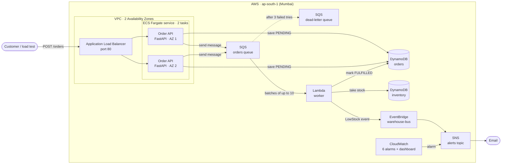
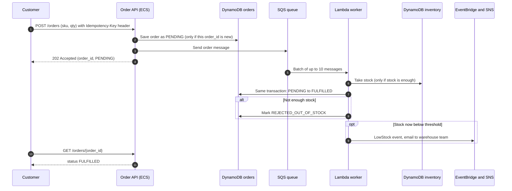
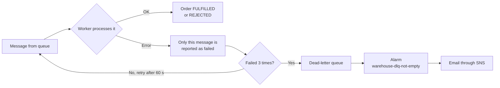
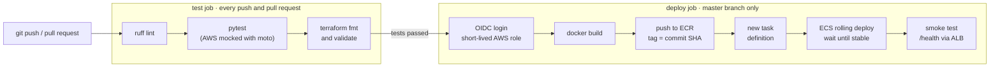
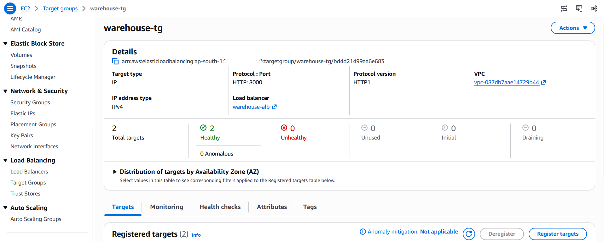
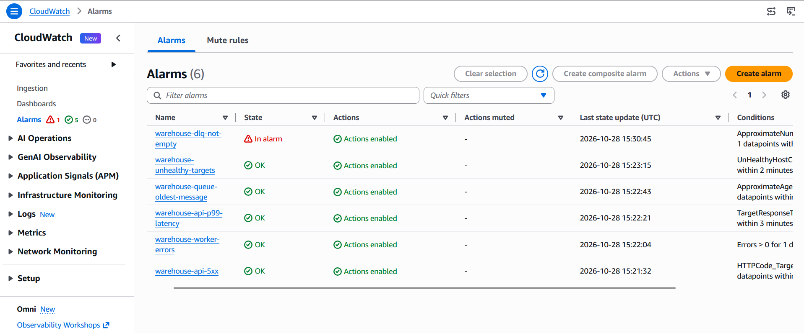
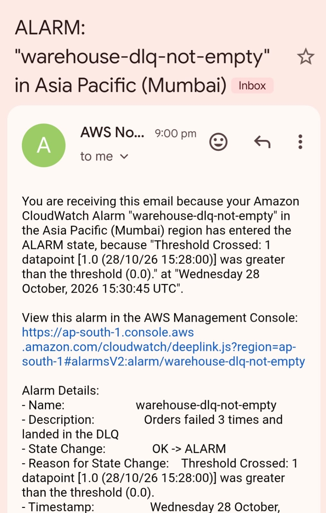
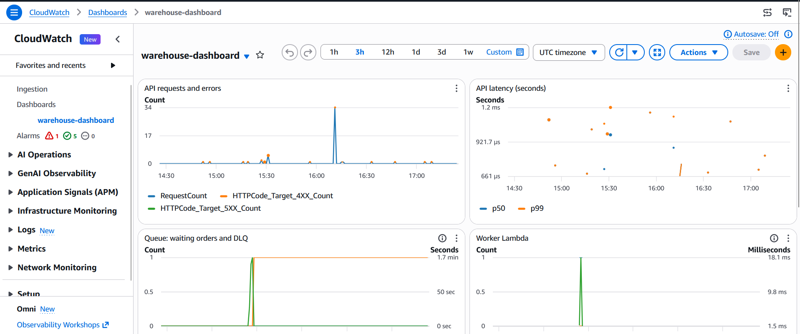
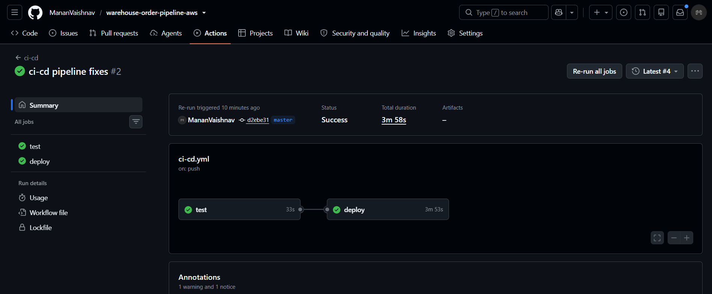
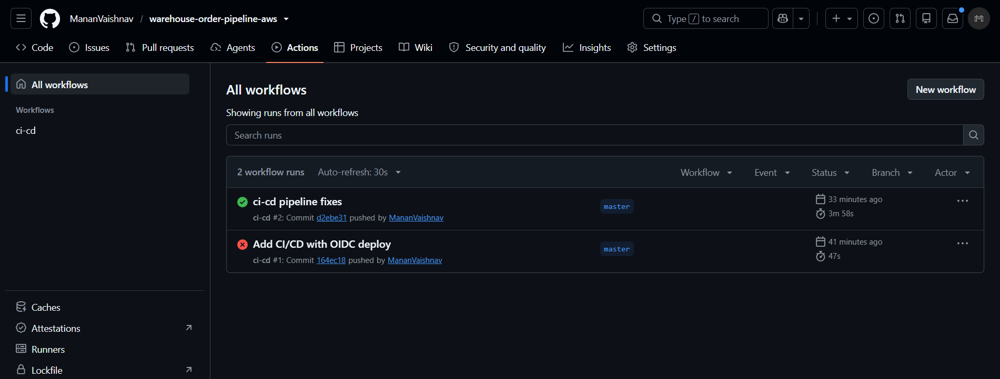

# Warehouse Order Pipeline on AWS


An event-driven order system for a warehouse, built on AWS with Terraform and deployed by a GitHub Actions pipeline.

A customer places an order and gets an answer right away. A background worker then takes the stock and confirms the order. If stock gets low, the warehouse team gets an email. If something breaks, an alarm emails the on-call person.

**Built with:** Python (FastAPI), Docker, ECS Fargate, Application Load Balancer, SQS, Lambda, DynamoDB, EventBridge, SNS, CloudWatch, IAM, Terraform, GitHub Actions (OIDC).

---

## Contents

- [What it does](#what-it-does)
- [Architecture](#architecture)
- [How an order moves through the system](#how-an-order-moves-through-the-system)
- [What happens when something fails](#what-happens-when-something-fails)
- [CI/CD pipeline](#cicd-pipeline)
- [Security](#security)
- [Monitoring](#monitoring)
- [Results](#results)
- [Screenshots](#screenshots)
- [What broke while building it, and how I fixed it](#what-broke-while-building-it-and-how-i-fixed-it)
- [Repository layout](#repository-layout)
- [How to run it](#how-to-run-it)
- [Known limits and next steps](#known-limits-and-next-steps)

---

## What it does

| Step | What happens |
| --- | --- |
| 1. Customer places an order | `POST /orders` saves the order as `PENDING` and puts it on a queue. The API replies `202 Accepted` in milliseconds, without waiting for the warehouse work. |
| 2. Worker processes the order | A Lambda function reads orders from the queue, takes the stock and marks the order `FULFILLED` in **one database transaction**. |
| 3. Not enough stock | The order is marked `REJECTED_OUT_OF_STOCK`. Stock can never go below zero. |
| 4. Stock gets low | The worker sends a `LowStock` event, and the warehouse team gets an email. |
| 5. Something goes wrong | Bad messages are retried 3 times, then parked in a dead-letter queue, and an alarm sends an email. |

**Why a queue in the middle?** The API stays fast and keeps accepting orders even if the worker is slow or down. Orders wait safely in the queue and are processed when the worker catches up.

## Architecture



| Part | Why it's there |
| --- | --- |
| **Application Load Balancer** | One public address. It spreads traffic over 2 API tasks and only sends traffic to tasks that pass the `/health` check. |
| **ECS Fargate, 2 tasks in 2 AZs** | Runs the API container without managing servers. If one task or one Availability Zone fails, the other keeps serving. |
| **SQS queue and dead-letter queue** | Separates "accept the order" from "process the order". Failed messages are retried, then moved aside so they don't block the rest. |
| **Lambda worker** | Processes orders in batches and scales on its own with the queue. |
| **DynamoDB** | `orders` and `inventory` tables, on-demand capacity, point-in-time recovery on. |
| **EventBridge and SNS** | The low-stock rule matches `LowStock` events and sends an email through SNS. Alarms use the same SNS topic. |
| **ECR** | Stores the API images. Tags can't be overwritten, and every image is scanned on push. |
| **CloudWatch** | Logs, 6 alarms and one dashboard for the whole pipeline. |

All of it is written in Terraform in [`infra/`](infra/).

## How an order moves through the system



**Three rules keep the data correct:**

1. **No overselling.** The stock update only succeeds if `stock >= qty`, checked inside DynamoDB, so two orders at the same moment can't both take the last item.
2. **No double processing.** SQS can deliver the same message twice. The order update only succeeds if the status is still `PENDING`, so a repeated message is skipped and stock is taken only once.
3. **No duplicate orders.** If a customer's app retries `POST /orders` with the same `Idempotency-Key`, the API returns the first order instead of creating a second one.

The stock change and the order update run in **one DynamoDB transaction**, so either both happen or neither does.

## What happens when something fails



| Failure | What the system does |
| --- | --- |
| One bad message in a batch | The worker reports **only that message** as failed (partial batch response). The other messages in the batch are not retried. |
| A message keeps failing | After 3 tries it moves to the dead-letter queue, and the alarm emails within about 2–3 minutes. |
| An API task crashes | The load balancer stops sending it traffic. ECS starts a new task, and the second task keeps serving meanwhile. |
| A bad version is deployed | New tasks fail the health check. The ECS deployment circuit breaker stops the rollout and **rolls back** to the last working version. |
| DynamoDB can't be reached | `/health` fails (returns `503` or times out), so the load balancer takes that task out of rotation. |

## CI/CD pipeline



- **Pull requests** only run the `test` job. They get no AWS access at all.
- **Pushes to `master`** run the tests, then deploy. A full run takes about **4 minutes** (test 33 s, deploy 3 min 53 s).
- **No AWS keys are stored in GitHub.** The job gets a signed OIDC token from GitHub and swaps it for 1-hour AWS credentials.
- **Every image is tagged with its commit SHA,** and tags can't be overwritten. Any running version can be traced back to the exact commit.
- **Rolling deploy with rollback.** ECS replaces tasks one by one, and the circuit breaker rolls back if the new tasks don't become healthy.

The workflow is in [`.github/workflows/ci-cd.yml`](.github/workflows/ci-cd.yml).

## Security

I built this with least-privilege access at every level:

| Area | What I did |
| --- | --- |
| **My own IAM user** | Terraform runs as a limited IAM user, not an admin. It can only create resources named `warehouse-*`. Network resources must carry the tag `project=warehouse`, and everything is locked to `ap-south-1`. It can only attach a short list of approved policies to roles, which blocks privilege escalation. |
| **GitHub deploy role** | Can only be used from the `master` branch of this one repository. The trust policy matches the repo's permanent owner and repo IDs, so a recreated repo with the same name can't use it. It can push to **one** ECR repository, update **one** ECS service, and pass only the 2 API roles, only to ECS. |
| **App permissions** | Separate roles for ECS itself (pull the image, write logs) and for the app code. The API can only write and read orders and send to one queue. The worker can only update the 2 tables, use its queue, and send events to one bus. |
| **Network** | The tasks accept traffic **only from the load balancer's security group**, on port 8000. They can only send HTTPS out. The load balancer drops invalid HTTP headers. |
| **Container** | Runs as a non-root user with a read-only root filesystem. Images are scanned on push. |
| **Secrets** | No AWS keys in code, Terraform files, or GitHub. `terraform.tfvars` and state files are git-ignored. |
| **Data** | SQS encryption at rest on both queues. DynamoDB point-in-time recovery on both tables. |

## Monitoring

All alarms email through the same SNS topic, both when they fire and when they recover.

| Alarm | Fires when | What it means |
| --- | --- | --- |
| `warehouse-dlq-not-empty` | Any message in the dead-letter queue | An order failed 3 times and needs a look |
| `warehouse-queue-oldest-message` | Oldest waiting order is over 2 minutes old, for 3 minutes | The worker is falling behind |
| `warehouse-worker-errors` | The worker Lambda crashed | A bug or permission problem in the worker |
| `warehouse-api-5xx` | More than 5 server errors in a minute | The API is failing requests |
| `warehouse-api-p99-latency` | p99 response time over 1 second, for 3 minutes | The API is slow for some users |
| `warehouse-unhealthy-targets` | Any API task failing health checks, for 2 minutes | A task is broken, or a bad deploy is in progress |

The **`warehouse-dashboard`** shows, on one screen: API requests and errors, API latency (p50 and p99), queue depth and dead-letter queue, oldest message age, worker invocations, errors and duration, ECS CPU and memory, and healthy vs unhealthy tasks.

## Results

Everything below was checked on the live stack in `ap-south-1`. Details are in [`docs/results.md`](docs/results.md).

| Check | Result |
| --- | --- |
| Unit tests (worker logic, AWS mocked with moto) | 4 / 4 pass, in every pipeline run |
| Order goes `PENDING` to `FULFILLED` end to end | ✅ |
| Low stock sends an email | ✅ SKU-0002 dropped to 14 (threshold 15), email received |
| API through the load balancer, 2 healthy tasks in 2 AZs | ✅ |
| Poison message: 3 tries, dead-letter queue, alarm email | ✅ Alarm `warehouse-dlq-not-empty` went to ALARM at 15:30:45 UTC on the 15:28 data point, and the email arrived |
| CI/CD: lint, tests, Terraform checks, build, push, deploy, smoke test | ✅ 3 min 58 s end to end |

Planned next: load test with Locust (throughput, p50/p99 latency), task-kill recovery time, and a bad-deploy rollback test. I'll add the numbers to [`docs/results.md`](docs/results.md).

## Screenshots

**2 healthy API tasks behind the load balancer**



**CloudWatch alarms. The dead-letter queue alarm fired during the poison-message test**



**Alarm email**



**CloudWatch dashboard**



**CI/CD pipeline: test and deploy jobs**





## What broke while building it, and how I fixed it

| Problem | Cause | Fix |
| --- | --- | --- |
| `terraform apply` failed creating the SQS trigger for the Lambda (`lambda:TagResource` denied) | Terraform's `default_tags` tag the event source mapping when it's created, and my limited IAM user couldn't tag it | Allowed tag and read actions **only** on `event-source-mapping` resources, not on all of Lambda |
| `docker build` failed in WSL with "Network is unreachable" during `pip install` | The Docker build network couldn't reach the internet from WSL | Built with `--network=host` |
| The container started but `/health` hung | The WSL network interface uses MTU 1400 while the Docker bridge used 1500, so bigger packets to AWS were silently dropped | Set `"mtu": 1400` in Docker's `daemon.json` so the container matches the WSL network |
| One image push showed 3 entries in ECR | Docker adds an image index and a build-provenance record by default | Built with `--platform linux/amd64 --provenance=false --sbom=false`, and switched to versioned, immutable tags |
| Creating subnets, route table and security groups was denied | With tag-based IAM, `CreateSubnet` is checked against the **new subnet** (request tag) **and the existing VPC** (resource tag). My policy only covered the first | Added a statement allowing these actions **only inside VPCs tagged** `project=warehouse`, instead of opening it to every VPC |
| Creating the load balancer was denied (`ec2:GetSecurityGroupsForVpc`) | The load balancer calls a read-only action that isn't part of `ec2:Describe*` | Added that one read action |
| GitHub Actions: `Not authorized to perform sts:AssumeRoleWithWebIdentity`, even though repo, branch and role looked right | GitHub's token used a subject with permanent IDs (`repo:Owner@<id>/repo@<id>:ref:...`). My trust policy expected the plain `repo:Owner/repo:ref:...` format | Found the real subject in the failed `AssumeRoleWithWebIdentity` event in **CloudTrail** and matched it exactly. I kept the strict exact-match condition instead of loosening it to a wildcard |

## Repository layout

```
.
├── .github/workflows/ci-cd.yml   # Pipeline: test on every push/PR, deploy on master
├── app/                          # Order API (FastAPI) and its Dockerfile
│   ├── main.py
│   ├── Dockerfile
│   └── requirements.txt
├── worker/handler.py             # Lambda worker: stock transaction, reject, low-stock event
├── infra/                        # Terraform
│   ├── providers.tf  variables.tf  outputs.tf
│   ├── network.tf                # VPC, 2 public subnets, security groups
│   ├── alb.tf  ecs.tf  ecr.tf    # Load balancer, Fargate service, image repository
│   ├── sqs.tf  lambda.tf         # Queue + DLQ, worker and its trigger
│   ├── dynamodb.tf  events.tf  sns.tf
│   └── monitoring.tf             # 6 alarms + dashboard
├── scripts/seed_inventory.py     # Loads 50 sample products
├── tests/                        # Unit tests for the worker (moto)
└── docs/
    ├── results.md                # What was tested and the results
    ├── results/                  # Raw test output
    └── screenshots/
```

## How to run it

**You need:** an AWS account, AWS CLI v2, Terraform 1.6+, Docker, and Python 3.12.

**1. Set your variables**

```bash
cp infra/terraform.tfvars.example infra/terraform.tfvars
# set alert_email in infra/terraform.tfvars
```

**2. Create the image repository and push the first image**

```bash
terraform -chdir=infra init
terraform -chdir=infra apply -target=aws_ecr_repository.api

ECR_URL=$(terraform -chdir=infra output -raw ecr_repository_url)
aws ecr get-login-password --region ap-south-1 | docker login --username AWS --password-stdin "${ECR_URL%%/*}"
docker build --platform linux/amd64 --provenance=false --sbom=false -t "$ECR_URL:v1" app/
docker push "$ECR_URL:v1"
```

**3. Create everything else and load sample products**

```bash
terraform -chdir=infra apply
python scripts/seed_inventory.py
```

Confirm the SNS subscription email that AWS sends you, so you can receive alerts.

**4. Try it**

```bash
ALB=$(terraform -chdir=infra output -raw alb_dns_name)
curl "http://$ALB/health"
curl -X POST "http://$ALB/orders" -H 'Content-Type: application/json' -d '{"sku":"SKU-0005","qty":1}'
curl "http://$ALB/orders/<order_id>"      # FULFILLED after a second or two
```

Interactive API docs are at `http://<alb_dns_name>/docs`.

| Endpoint | What it does |
| --- | --- |
| `POST /orders` | Places an order. Body: `{"sku": "SKU-0001", "qty": 1}`. Optional `Idempotency-Key` header. Returns `202` with `order_id` |
| `GET /orders/{order_id}` | Order status: `PENDING`, `FULFILLED` or `REJECTED_OUT_OF_STOCK` |
| `GET /health` | `200` if the API can reach DynamoDB, otherwise `503` |

**5. Run the tests locally**

```bash
pip install -r requirements-dev.txt
ruff check .
pytest -q
```

**6. Turn on CI/CD (optional)**

1. In IAM, add the identity provider `token.actions.githubusercontent.com` with audience `sts.amazonaws.com`.
2. Create a role that trusts it, limited to your repo's `master` branch. Give it the ECR push, ECS deploy and limited `iam:PassRole` permissions described in [Security](#security).
3. In GitHub, add the repository secrets `AWS_DEPLOY_ROLE_ARN` and `ALB_DNS`.

**7. Clean up**

```bash
terraform -chdir=infra destroy
```

The load balancer and the 2 Fargate tasks are billed by the hour, roughly US$1–1.5 per day together. Destroy the stack when you're not using it.

## Known limits and next steps

- **Order saved, but sending to the queue fails.** The order would stay `PENDING`. The fix is a transactional outbox (DynamoDB Streams to the queue) or a job that re-queues old `PENDING` orders.
- **Public subnets, no NAT Gateway.** I chose this to keep cost low. The tasks only accept traffic from the load balancer, but production would use private subnets with VPC endpoints.
- **HTTP only.** HTTPS needs a domain and an ACM certificate.
- **Local Terraform state.** A team setup would use an S3 backend with state locking.
- **Next:** a Locust load test, task-kill recovery timing and a bad-deploy rollback test, with the numbers in [`docs/results.md`](docs/results.md).
